# ioBroker.sunseeker

[Zurück zur README](/README.md)

Entwickelt und getestet wurde dieser Adapter mit 2 x Sunnseeker S4. Alle andere Modelle sollten auch steuerbar sein.
Wenn Einstellungen fehlen, dann bitte ein Issue anlegen oder im Forum anfragen.

```:warning:
 ⚠ Bitte nicht iobroker und Home-Assistant nicht parallel laufen lassen. Wenn erforderlich, dann bitte `xxx.map.livemap_update` deaktivieren und den Intervall auf 1440 setzen.
 ⚠ Fehlerhafte Points können die Map unbrauchbar machen. Änderungen im Code könnten den Mäher unbrauchbar machen.
```

# Zusammenfassung

- [Instanz Einstellungen](#instanz-einstellungen)
    - [Adaptereinstellungen](#adaptereinstellungen)
- [Ordnerstruktur](#ordnerstruktur)
- [antiTheft](#diebstahlsicherung)
- [events](#protokolle)
    - [Beispiel Ereignisbenachrichtigung](#eventnotification)
    - [Beispiel tägliche Event](#events)
    - [Beispiel Systemnachrichten](#systemmessage)
- [expert](#expert)
- [map](#map)
    - [Leere Bereiche](#leere-bereiche)
    - [Verbotene Bereiche](#verbotene-bereiche)
    - [Aktuelle Map Infos](#aktuelle-map-infos)
    - [Livemap-Einstellungen](#livemap-einstellungen)
    - [Maps (Backup Maps)](#maps-backup-maps)
    - [Hindernisse](#hindernisse)
    - [Durchgänge](#durchgänge)
    - [Muster](#muster)
    - [Sichere Bereiche (placed_blank)](#sichere-bereiche-placed_blank)
    - [Zonen Übersicht](#zonen-übersicht)
        - [Benutzdefinierter JSON für alle Zonen anwenden](#setallcustomraw)
    - [Zone](#zone)
        - [Points](#points)
        - [Array](#array)
        - [Inhalt start_mowing_selected_area](#inhalt-start_mowing_selected_area)
    - [Benutzerdefinierte Zonen Einstellung](#benutzerdefinierte-zonen-einstellung)
        - [Benutzdefinierter JSON für die Zonen Einstellungen anwenden](#setcustomraw)
- [mower_raw](#alle-daten-vom-mäher-von-der-cloud-und-mqtt-verbindung)
- [notice](#logs)
- [remote](#remote-control)
- [schedule](#zeitplan)
- [settings](#einstellungen)
    - [Einstellungen Winkel](#einstellungen-multi-winkel)
- [skins](#skins)
- [communities](#communities)
- [cards](#kreditkarten)
- [auth](#autorisierung)
- [rateLimit](#request-begrenzung)
    - [Beispiel Request JSON](#json-request)
    - [Beispiel Restart JSON](#json-restart)

# Instanz Einstellungen

### Adaptereinstellungen

[Zusammenfassung](#zusammenfassung)

| Einstellung                                           | Beschreibung                                                                                                                                                                                                                                                                            |
| ----------------------------------------------------- | --------------------------------------------------------------------------------------------------------------------------------------------------------------------------------------------------------------------------------------------------------------------------------------- |
| `Benutzername / E-Mail`                               | Benutzername                                                                                                                                                                                                                                                                            |
| `Passwort`                                            | Passwort                                                                                                                                                                                                                                                                                |
| `Region`                                              | Region auswählen - EU oder US                                                                                                                                                                                                                                                           |
| `Neu, wenn Ihr Mäher kabellos ist`                    | Neue Modelle wie S/X/V/V1 und Old für Mäher mit Kabel (siehe Readme)                                                                                                                                                                                                                    |
| `Abfrageintervall (Minuten)`                          | Bis auf die Benachrichtigungseinstellung kommen alle Daten auch über die Mqtt Verbindungen. Man kann auch manuell mit dem Button `notice.update` ein Update starten. Wechselt man z: Bsp. auf 5 Minuten benötigt der Adapter ca. 6000 Anfragen. Bei 60 Minuten sind es nur 400 Anfragen |
| `Sprache (Bekannte Sprachen: da, de, fr, fi, pl, en)` | Sprache für Benutzeroberfläche und Ereigniscode                                                                                                                                                                                                                                         |
| `HTTPS-Anfragelimit (500–10000)`                      | Maximale Anfragen die der Adapter pro Tag versenden darf. Schutz bei Änderungen der API.                                                                                                                                                                                                |
| `Grenzwert für den Neustart des Adapters`             | Maximale Adapterneustart pro Tag. Schutz bei Änderungen der API.                                                                                                                                                                                                                        |
| `Fehlergrenze für HTTP-Anfragen`                      | Maximale Anfragen an die Cloud die fehlerhaft ist. Schutz bei Änderungen der API.                                                                                                                                                                                                       |
| `MQTT-Daten löschen`                                  | Zugangsdaten für die Mqtt-Verbindung löschen und neu anlegen. Nur wenn es Probleme gibt oder auf Aufforderung eines Entwickler                                                                                                                                                          |
| `Sitzungsdaten löschen`                               | Zugangsdaten für die Cloud-Verbindung löschen und neu anlegen. Nur wenn es Probleme gibt oder auf Aufforderung eines Entwickler                                                                                                                                                         |

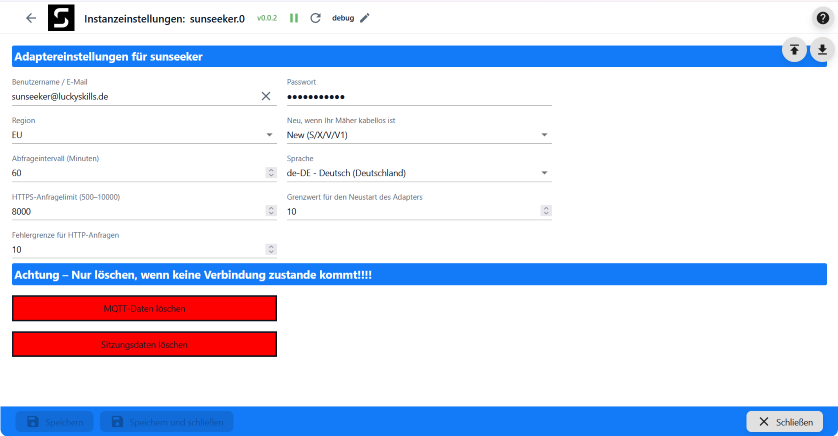

[Zusammenfassung](#zusammenfassung)

### Ordnerstruktur

| Objekt channel  | Beschreibung                                                                                          |
| --------------- | ----------------------------------------------------------------------------------------------------- |
| xxx             | Seriennummer vom Mäher (device)                                                                       |
| xxx.antiTheft   | Diebstahlsicherung (4G oder GPS Modul)                                                                |
| xxx.events      | Ereignisprotokolle                                                                                    |
| xxx.expert      | Nur für Entwickler sichtbar                                                                           |
| xxx.map         | Einstellungen Zonen, Maps, Areas und Muster                                                           |
| xxx.mower_raw   | Alle Daten von der Cloud und Mqtt Verbindung (nur sehen)                                              |
| xxx.notice      | Benachritigungseinstellungen                                                                          |
| xxx.remote      | Remote Control                                                                                        |
| xxx.schedule    | Einstellungen Mähplan. Es sind nur 2 pro Tag möglich                                                  |
| xxx.settings    | Allgemeine Einstellungen                                                                              |
| xxx.skins       | in Arbeit                                                                                             |
| xxx.communities | in Arbeit                                                                                             |
| xxx.cards       | in Arbeit                                                                                             |
| auth            | Zugangsdaten und Status der Mqtt Verbindungen                                                         |
| info            | Verbindung Clound und Mqtt. Es gibt max. 3 Verbindungen. Geht nur eine Offline wird der Adapter gelb. |
| rateLimit       | Infos Rate Limit (Error wird nicht angezeigt)                                                         |

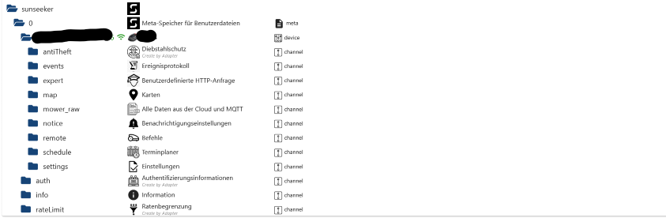

[Zusammenfassung](#zusammenfassung)

### Diebstahlsicherung

| Objekt Id                      | Beschreibung                           |
| ------------------------------ | -------------------------------------- |
| xxx.antiTheft.batteryVoltage   | Anzeige Voltstatus                     |
| xxx.antiTheft.bindDeviceSn     | Serienumber vom verbundenen Mäher      |
| xxx.antiTheft.deviceOnlineFlag | Modul Status                           |
| xxx.antiTheft.fence            | Größe vom digitale Zaun L/M/H          |
| xxx.antiTheft.fenceCenterLat   | Breitengrad (Mitte vom digitalen Zaun) |
| xxx.antiTheft.fenceCenterLon   | Längengrad (Mitte vom digitalen Zaun)  |
| xxx.antiTheft.fence_digital    | Digitaler Zaun aktivieren/deaktivieren |
| xxx.antiTheft.lastOnlineTime   | Letzter Statuswechsel auf Online       |
| xxx.antiTheft.lastPositionTime | Zeit der letzten Position              |

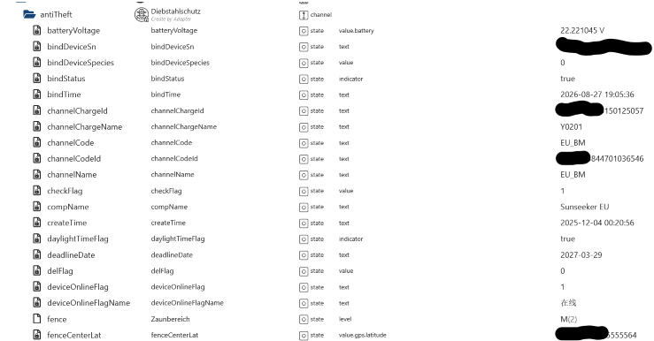
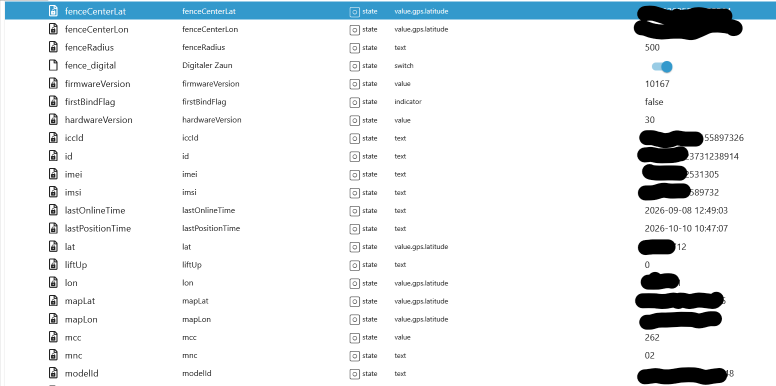
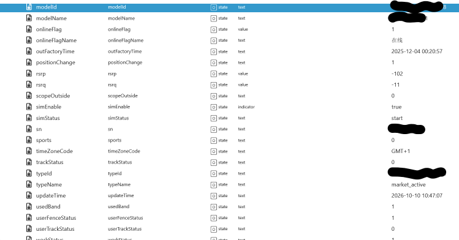
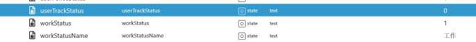

[Zusammenfassung](#zusammenfassung)

### Protokolle

| Objekt Id                      | Beschreibung                        |
| ------------------------------ | ----------------------------------- |
| xxx.events.eventNotification   | Ereignisbenachrichtigung            |
| xxx.events.eventUpdate         | Alle Events neu laden               |
| xxx.events.events              | Tägliche Event                      |
| xxx.events.makeAllRead         | Alle Events als `gelesen` markieren |
| xxx.events.systemMessage       | Systemnachrichten                   |
| xxx.events.unreadEventMessage  | Anzahl ungelesene Events            |
| xxx.events.unreadSystemMessage | Anzahl ungelesen Systemnachrichten  |

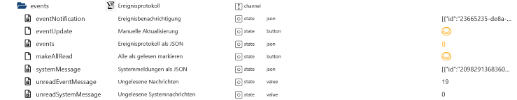

[Zusammenfassung](#zusammenfassung)

### eventNotification

```json
[
    {
        "id": "25046fa6-7766-4ed4-87a0-952f515442ca",
        "sn": null,
        "workRecordId": "0",
        "type": 2,
        "code": "Regen erkannt",
        "poseX": "",
        "poseY": "",
        "time": "1791584104176",
        "timeStr": "2026-10-09 22:15:04",
        "timeZoneId": "Europe/Berlin",
        "count": null,
        "nrtkBase": 0,
        "firmwareVersion": "1.1.28.3103"
    },
    {
        "id": "6f351d8c-9832-4e5b-b4b5-7c306151f1c9",
        "sn": null,
        "workRecordId": "0",
        "type": 2,
        "code": "Regen erkannt",
        "poseX": "",
        "poseY": "",
        "time": "1791403996503",
        "timeStr": "2026-10-07 20:13:16",
        "timeZoneId": "Europe/Berlin",
        "count": null,
        "nrtkBase": 0,
        "firmwareVersion": "1.1.28.3103"
    },
    {
        "id": "917a42c4-edd1-49cc-9f2f-ebebfae9342a",
        "sn": null,
        "workRecordId": "0",
        "type": 2,
        "code": "Der Roboter lädt",
        "poseX": "",
        "poseY": "",
        "time": "1791382963985",
        "timeStr": "2026-10-07 14:22:43",
        "timeZoneId": "Europe/Berlin",
        "count": null,
        "nrtkBase": 0,
        "firmwareVersion": "1.1.28.3103"
    }
]
```

### events

```json
[
  {
    "id": "2087778142705917953",
    "start": "1786598551",
    "end": "1786600074",
    "time": 1523,
    "area": 49,
    "normalDone": true,
    "url": "https://minio.sk-robot.com/work-record/xxx_1786598551_1786600074_record.gz",
    "sn": "xxx",
    "subMode": 0,
    "startReason": "Das Gerät wird neu gestartet",
    "endReason": "Arbeit abgeschlossen. Rückkehr zur Ladestation.",
    "timeZoneId": "",
    "workProcessInfos": null,
    "taskType": 3,
    "oneshotTaskType": 0,
    "firmwareVersion": "1.1.23.2938",
    "targetRegions": null,
    "workOrder": null,
    "workProcessInfoPage": null
  },
  {
    "id": "2087597114861350914",
    "start": "1786555135",
    "end": "1786556912",
    "time": 1775,
    "area": 48,
    "normalDone": true,
    "url": "https://minio.sk-robot.com/work-record/xxx_1786555135_1786556912_record.gz",
    "sn": "123",
    "subMode": 0,
    "startReason": "Das Gerät wird neu gestartet",
    "endReason": "Arbeit abgeschlossen. Rückkehr zur Ladestation.",
    "timeZoneId": "",
    "workProcessInfos": null,
    "taskType": 3,
    "oneshotTaskType": 0,
    "firmwareVersion": "1.1.23.2938",
    "targetRegions": null,
    "workOrder": null,
    "workProcessInfoPage": null
  },
  {
    "id": "2087455142109900802",
    "start": "1786521294",
    "end": "1786523062",
    "time": 1765,
    "area": 48,
    "normalDone": true,
    "url": "https://minio.sk-robot.com/work-record/xxx_1786521294_1786523062_record.gz",
    "sn": "1223",
    "subMode": 0,
    "startReason": "Das Gerät wird neu gestartet",
    "endReason": "Arbeit abgeschlossen. Rückkehr zur Ladestation.",
    "timeZoneId": "",
    "workProcessInfos": null,
    "taskType": 3,
    "oneshotTaskType": 0,
    "firmwareVersion": "1.1.23.2938",
    "targetRegions": null,
    "workOrder": null,
    "workProcessInfoPage": null
  },
```

### systemMessage

```json
[
    {
        "id": "2098292481602727980",
        "appUserId": 12632759,
        "title": "Aktion für 70 Beta-Tester",
        "content": "Gehören Sie zu den Ersten, die unsere neue Technologie erleben, und gestalten Sie mit, was als Nächstes kommt.",
        "readFlag": true,
        "createdAt": "2026-09-11 06:07:59",
        "messageTypeCode": "communityActivityMessage",
        "feedbackContent": null,
        "sendAt": "1789106879",
        "type": 1,
        "sn": null,
        "userDelFlag": false,
        "messageCode": null,
        "nrtkBase": null
    },
    {
        "id": "2084552495081664535",
        "appUserId": 12632759,
        "title": "Gewinnen Sie einen Sunseeker Elite X Gen 2 – Das Gewinnspiel läuft noch!",
        "content": "Teilen Sie Ihr Feedback und gewinnen Sie mit etwas Glück X Gen 2 Mähroboter und Merchandise-Pakete. Gesamtwert der Preise: über 8.000 €.",
        "readFlag": true,
        "createdAt": "2026-08-04 08:10:01",
        "messageTypeCode": "communityActivityMessage",
        "feedbackContent": null,
        "sendAt": "1785831001",
        "type": 1,
        "sn": null,
        "userDelFlag": false,
        "messageCode": null,
        "nrtkBase": null
    },
    {
        "id": "2083090986003931175",
        "appUserId": 12632759,
        "title": "Umfrage-Gewinnspiel – Gewinnen Sie einen Sunseeker Elite X Gen 2!",
        "content": "Teilen Sie Ihr Feedback und gewinnen Sie X Gen 2 Mähroboter sowie Merchandise-Pakete. Gesamtwert der Preise: über 8.000 €.",
        "readFlag": true,
        "createdAt": "2026-07-31 07:22:39",
        "messageTypeCode": "communityActivityMessage",
        "feedbackContent": null,
        "sendAt": "1785482559",
        "type": 1,
        "sn": null,
        "userDelFlag": false,
        "messageCode": null,
        "nrtkBase": null
    }
]
```

[Zusammenfassung](#zusammenfassung)

### Expert

`Nur für Entwickler. Es ist möglich Anfragen direkt an die Cloud zu senden.`

| Objekt Id           | Beschreibung             |
| ------------------- | ------------------------ |
| xxx.expert.request  | Eigener Request als JSON |
| xxx.expert.response | Response                 |

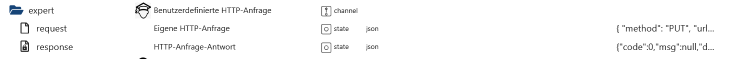

[Zusammenfassung](#zusammenfassung)

### Map

| Objekt Id              | Beschreibung                                    |
| ---------------------- | ----------------------------------------------- |
| xxx.map.blank          | Leere Bereiche                                  |
| xxx.map.forbidden      | Verbotene Zonen                                 |
| xxx.map.info           | Info der aktuellen Karte                        |
| xxx.map.map_settings   | Livemap Einstellungen                           |
| xxx.map.maps           | Backup Maps                                     |
| xxx.map.obstacles      | Hindernisse                                     |
| xxx.map.passages       | Durchgänge                                      |
| xxx.map.pattern        | Muster                                          |
| xxx.map.placed_blank   | Sichere Bereiche                                |
| xxx.map.zones          | Zonen                                           |
| xxx.map.backup         | Backup Maps als JSON (Daten für `xxx.map.maps`) |
| xxx.map.livemap        | Livemap                                         |
| xxx.map.livemap_update | Livemap beim mähen aktualisieren                |
| xxx.map.mapData        | Daten der aktiven Map (alle Points)             |
| xxx.map.net            | Netzwerk Abdeckung als Karte                    |
| xxx.map.pathData       | Daten der Mählinie                              |
| xxx.map.texture        | Texturen als Karte                              |
| xxx.map.wifi           | Wifi Abdeckung als Karte                        |

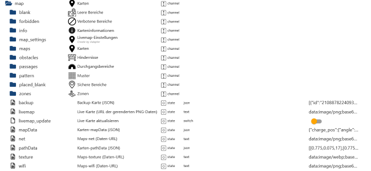

[Zusammenfassung](#zusammenfassung)

### Leere Bereiche

| Objekt Id                     | Beschreibung              |
| ----------------------------- | ------------------------- |
| xxx.map.blank.01.delete_blank | Leeren Bereich löschen    |
| xxx.map.blank.01.id           | ID                        |
| xxx.map.blank.01.points       | Points vom leeren Bereich |
| xxx.map.blank.01.points_num   | Anzahl der Points         |

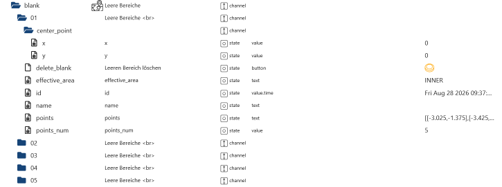

[Zusammenfassung](#zusammenfassung)

### Verbotene Bereiche

| Objekt Id                             | Beschreibung                                                                                                       |
| ------------------------------------- | ------------------------------------------------------------------------------------------------------------------ |
| xxx.map.forbidden.01.delete_forbidden | Verbotene Bereich löschen                                                                                          |
| xxx.map.forbidden.01.effective_area   | Im Bereich oder ausserhalb vom Bereich                                                                             |
| xxx.map.forbidden.01.id               | Timestamp wann der Bereich erstellt wurde                                                                          |
| xxx.map.forbidden.01.name             | Kann nicht vergeben werden                                                                                         |
| xxx.map.forbidden.01.points           | Points vom Bereich.                                                                                                |
| xxx.map.forbidden.01.points_num       | Anzahl der Points                                                                                                  |
| xxx.map.forbidden.01.tag              | Tag vom Bereich (2+dark=Nacht, 1+nomal=Wand, 2+normal=Allgemein)                                                   |
| xxx.map.forbidden.01.type             | Typ vom Bereich (Allgemein, Nacht oder Wand)                                                                       |
| xxx.map.forbidden.forbidden_create    | Verbotene Bereich anlegen                                                                                          |
| xxx.map.forbidden.forbidden_map       | Vorschau der MAP mit den Points                                                                                    |
| xxx.map.forbidden.forbidden_points    | Points als Array (z. Bsp. Points aus .01.points). Verbotene Bereiche per VIS anlegen ist noch nicht implementiert. |
| xxx.map.forbidden.forbidden_type      | Allgemein, Nacht oder Wand                                                                                         |

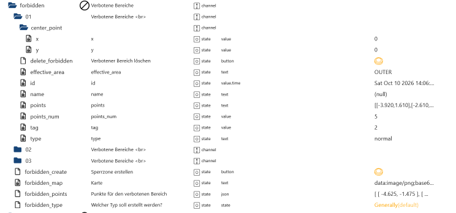

[Zusammenfassung](#zusammenfassung)

### Aktuelle Map Infos

| Objekt Id                    | Beschreibung                                                   |
| ---------------------------- | -------------------------------------------------------------- |
| xxx.map.info.mapModifyTime   | Zuletzt geöndert                                               |
| xxx.map.info.mapPathFileName | Dateiname                                                      |
| xxx.map.info.mapPathFileUrl  | URL Link um die Daten der aktuellen Karte herunterzuladen      |
| xxx.map.info.realPathFileUlr | URL Link um die Daten den aktuellen Mähverlauf herunterzuladen |

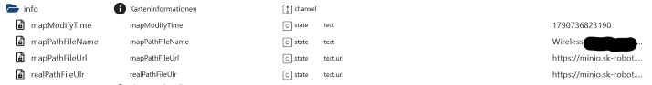

[Zusammenfassung](#zusammenfassung)

### Livemap-Einstellungen

| Objekt Id                                            | Beschreibung                                                               |
| ---------------------------------------------------- | -------------------------------------------------------------------------- |
| xxx.map.map_settings.charger_path                    | Pfad zum Bild der Ladestation                                              |
| xxx.map.map_settings.charger_scale                   | Bild der Ladestation Skalieren. Je kleinder der Wert um so größer das Bild |
| xxx.map.map_settings.divide_area_work_active         | Arbeitsbereiche aufteilen in der Map anzeigen                              |
| xxx.map.map_settings.divide_area_work_lineWidth      | Linienbreite                                                               |
| xxx.map.map_settings.divide_area_work_stroke         | Strichfarbe                                                                |
| xxx.map.map_settings.polyline_color                  | Farbe der Mählinie                                                         |
| xxx.map.map_settings.polyline_lineWidth              | Linienbreite                                                               |
| xxx.map.map_settings.region_channel_active           | Durchgänge anzeigen                                                        |
| xxx.map.map_settings.region_channel_fill             | Füllfarbe                                                                  |
| xxx.map.map_settings.region_channel_lineWidth        | Linienbreite                                                               |
| xxx.map.map_settings.region_channel_stroke           | Strichfarbe                                                                |
| xxx.map.map_settings.region_forbidden_active         | Verbotene Bereiche anzeigen                                                |
| xxx.map.map_settings.region_forbidden_dark_fill      | Füllfarbe                                                                  |
| xxx.map.map_settings.region_forbidden_dark_lineWidth | Linienbreite                                                               |
| xxx.map.map_settings.region_forbidden_dark_stroke    | Strichfarbe                                                                |
| xxx.map.map_settings.region_forbidden_fill           | Füllfarbe                                                                  |
| xxx.map.map_settings.region_forbidden_lineWidth      | Linienbreite                                                               |
| xxx.map.map_settings.region_forbidden_stroke         | Strichfarbe                                                                |
| xxx.map.map_settings.region_forbidden_wall_fill      | Füllfarbe                                                                  |
| xxx.map.map_settings.region_forbidden_wall_lineWidth | Linienbreite                                                               |
| xxx.map.map_settings.region_forbidden_wall_stroke    | Strichfarbe                                                                |
| xxx.map.map_settings.region_obstacle_active          | Hindernisse anzeigen                                                       |
| xxx.map.map_settings.region_obstacle_fill            | Füllfarbe                                                                  |
| xxx.map.map_settings.region_obstacle_lineWidth       | Linienbreite                                                               |
| xxx.map.map_settings.region_obstacle_stroke          | Strichfarbe                                                                |
| xxx.map.map_settings.region_pattern_active           | Muster anzeigen                                                            |
| xxx.map.map_settings.region_pattern_fill             | Füllfarbe                                                                  |
| xxx.map.map_settings.region_pattern_lineWidth        | Linienbreite                                                               |
| xxx.map.map_settings.region_pattern_stroke           | Strichfarbe                                                                |
| xxx.map.map_settings.region_placed_blank_active      | Sichere Bereiche anzeigen                                                  |
| xxx.map.map_settings.region_placed_blank_fill        | Füllfarbe                                                                  |
| xxx.map.map_settings.region_placed_blank_lineWidth   | Linienbreite                                                               |
| xxx.map.map_settings.region_placed_blank_stroke      | Strichfarbe                                                                |
| xxx.map.map_settings.region_work_fill                | Füllfarbe                                                                  |
| xxx.map.map_settings.region_work_lineWidth           | Linienbreite                                                               |
| xxx.map.map_settings.region_work_stroke              | Strichfarbe                                                                |
| xxx.map.map_settings.robot_charger_scale             | Bild vom Mäher Skalieren. Je kleinder der Wert um so größer das Bild       |
| xxx.map.map_settings.robot_path                      | Pfad zum Bild vom Mäher                                                    |

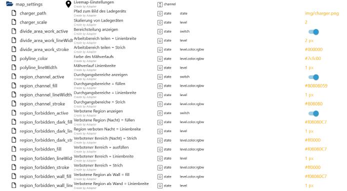
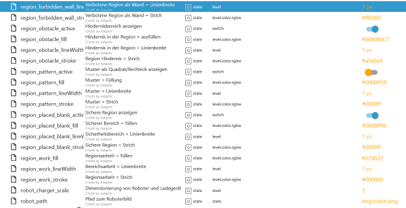

[Zusammenfassung](#zusammenfassung)

### Maps (Backup Maps)

| Objekt Id                     | Beschreibung                                                             |
| ----------------------------- | ------------------------------------------------------------------------ |
| xxx.map.maps.01.createTime    | Zeitstempel wann die Map erstellt wurde                                  |
| xxx.map.maps.01.delete        | Map löschen. Erst mit `xxx.map.maps.01.delete_select` bestätigen         |
| xxx.map.maps.01.delete_select | Map mit true zum löschen bestätigen                                      |
| xxx.map.maps.01.id            | ID                                                                       |
| xxx.map.maps.01.mapArea       | Mapfläche im m²                                                          |
| xxx.map.maps.01.mapId         | Map ID                                                                   |
| xxx.map.maps.01.mapName       | Map Name (änderbar)                                                      |
| xxx.map.maps.01.mapUrl        | Map URL                                                                  |
| xxx.map.maps.01.sn            | Seriennummer vom Mäher                                                   |
| xxx.map.maps.01.thumbnailUrl  | Kleine Map URL                                                           |
| xxx.map.maps.01.updateTime    | Letzte Änderung                                                          |
| xxx.map.maps.01.useThisMap    | Diese Map verwenden. Die aktuelle aktive Map muss vorher gelöscht werden |
| xxx.map.maps.01.used          | Map aktive                                                               |

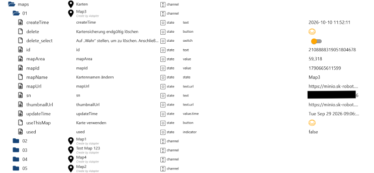

[Zusammenfassung](#zusammenfassung)

### Hindernisse

| Objekt Id                            | Beschreibung                                                                    |
| ------------------------------------ | ------------------------------------------------------------------------------- |
| xxx.map.obstacles.01.delete_obstacle | Hindernis löschen                                                               |
| xxx.map.obstacles.01.effective_area  | Im Bereich oder ausserhalb vom Bereich                                          |
| xxx.map.obstacles.01.id              | ID                                                                              |
| xxx.map.obstacles.01.name            | Keine Funktion                                                                  |
| xxx.map.obstacles.01.points          | Points vom Hindernis                                                            |
| xxx.map.obstacles.01.points_num      | Anzahl der Points                                                               |
| xxx.map.obstacles.obstacle_create    | Hindernis erstellen                                                             |
| xxx.map.obstacles.obstacle_map       | Vorschau vom Hindernis                                                          |
| xxx.map.obstacles.obstacle_points    | Points vom Hindernis. Hindernisse per VIS anlegen ist noch nicht implementiert. |

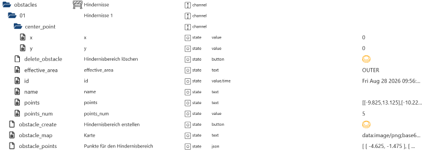

[Zusammenfassung](#zusammenfassung)

### Durchgänge

| Objekt Id                          | Beschreibung                                                                   |
| ---------------------------------- | ------------------------------------------------------------------------------ |
| xxx.map.passages.01.delete_passage | Durchgang löschen                                                              |
| xxx.map.passages.01.effective_area | Im Bereich oder ausserhalb vom Bereich                                         |
| xxx.map.passages.01.id             | ID                                                                             |
| xxx.map.passages.01.name           | Keine Funktion                                                                 |
| xxx.map.passages.01.points         | Points vom Durchgang.                                                          |
| xxx.map.passages.01.points_num     | Anzahl der Points                                                              |
| xxx.map.passages.01.split_line     | Trennlinie                                                                     |
| xxx.map.passages.passage_create    | Durchgang erstellen                                                            |
| xxx.map.passages.passage_map       | Vorschau vom Durchgang                                                         |
| xxx.map.passages.passage_points    | Points vom Durchgang. Durchgänge per VIS anlegen ist noch nicht implementiert. |

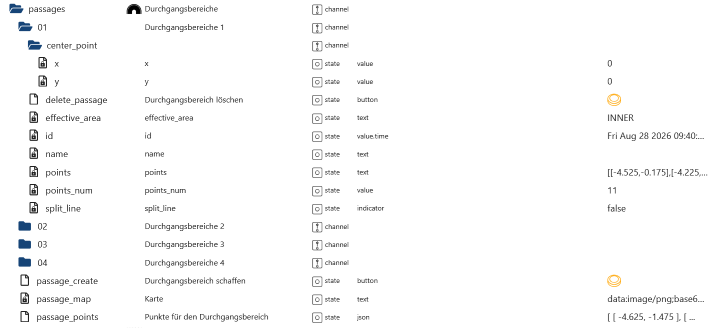

[Zusammenfassung](#zusammenfassung)

### Muster

| Objekt Id                          | Beschreibung                                                                                                                                                                                                               |
| ---------------------------------- | -------------------------------------------------------------------------------------------------------------------------------------------------------------------------------------------------------------------------- |
| xxx.map.pattern.01.area_id         | Area ID                                                                                                                                                                                                                    |
| xxx.map.pattern.01.effective_area  | Im Bereich oder ausserhalb vom Bereich                                                                                                                                                                                     |
| xxx.map.pattern.01.enable          | Muster aktivieren                                                                                                                                                                                                          |
| xxx.map.pattern.01.expiration_time | Ablaufdatum wann das Muster automatisch gelöscht wird                                                                                                                                                                      |
| xxx.map.pattern.01.id              | ID                                                                                                                                                                                                                         |
| xxx.map.pattern.01.img_value       | Muster ändern                                                                                                                                                                                                              |
| xxx.map.pattern.01.last_edit_time  | Zeitstempel wann das Muster zuletzt geändert wurde                                                                                                                                                                         |
| xxx.map.pattern.01.min_width       | Mindesgröße                                                                                                                                                                                                                |
| xxx.map.pattern.01.name            | Keine Funktion                                                                                                                                                                                                             |
| xxx.map.pattern.01.pattern_delete  | Muster löschen                                                                                                                                                                                                             |
| xxx.map.pattern.01.points          | Points vom Muster (Quadrat)                                                                                                                                                                                                |
| xxx.map.pattern.01.points_num      | Anzahl der Points                                                                                                                                                                                                          |
| xxx.map.pattern.create_pattern     | Muster erstellen. Erst `delete_automatic`, `points_pattern` und `selecte_pattern` auswählen                                                                                                                                |
| xxx.map.pattern.delete_all_pattern | Alle Muster löschen                                                                                                                                                                                                        |
| xxx.map.pattern.pattern_map        | Vorschau                                                                                                                                                                                                                   |
| xxx.map.pattern.points_pattern     | Muster per VIS anlegen ist noch nicht implementiert. Hier müssen die Points eingetragen werden. Einfach per APP einige Muster erstellen und sich die Points unter `xxx.map.mapData` -> `region_customize` heraus kopieren. |
| xxx.map.pattern.delete_automatic   | Zeit wann das neue Muster gelöscht werden soll                                                                                                                                                                             |
| xxx.map.pattern.selecte_pattern    | Muster auswählen                                                                                                                                                                                                           |

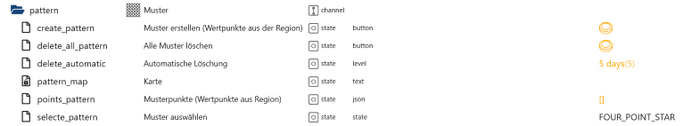

[Zusammenfassung](#zusammenfassung)

### Sichere Bereiche (placed_blank)

| Objekt Id                                   | Beschreibung                                                                             |
| ------------------------------------------- | ---------------------------------------------------------------------------------------- |
| xxx.map.placed_blank.01.delete_placed_blank | Sicheren Bereich löschen                                                                 |
| xxx.map.placed_blank.01.effective_area      | Im Bereich oder ausserhalb vom Bereich                                                   |
| xxx.map.placed_blank.01.id                  | ID                                                                                       |
| xxx.map.placed_blank.01.name                | Keine Funktion                                                                           |
| xxx.map.placed_blank.01.points              | Points vom sicheren Bereich                                                              |
| xxx.map.placed_blank.01.points_num          | Anzahl der Points                                                                        |
| xxx.map.placed_blank.placed_blank_create    | Sicheren Bereich mit den Points aus `xxx.map.placed_blank.placed_blank_points` erstellen |
| xxx.map.placed_blank.placed_blank_map       | Vorschau mit den Points aus `xxx.map.placed_blank.placed_blank_points`                   |
| xxx.map.placed_blank.placed_blank_points    | Points vom sicheren Bereich. Bereiche per VIS anlegen ist noch nicht implementiert.      |

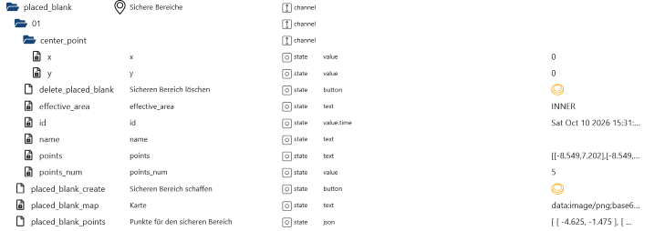

[Zusammenfassung](#zusammenfassung)

### Zonen Übersicht

| Objekt Id                              | Beschreibung                                                                                                                                                      |
| -------------------------------------- | ----------------------------------------------------------------------------------------------------------------------------------------------------------------- |
| xxx.map.zones.change_active_map_name   | Map Name ändern                                                                                                                                                   |
| xxx.map.zones.delete_active_map        | Aktive Map löschen `xxx.map.zones.delete_active_map_select` muss auf `true` stehen                                                                                |
| xxx.map.zones.delete_active_map_select | Mit `true` das Löschen bestätigen und dann `delete_active_map` drücken                                                                                            |
| xxx.map.zones.merge_zones              | Zonen zusammenführen z. Bsp. [Zone 1, Zone 2] == [1,2]                                                                                                            |
| xxx.map.zones.setAllCustomRaw          | Man kann auch den JSON anpassen und versenden statt die States zu ändern                                                                                          |
| xxx.map.zones.settings_all_zones       | 0 für Standardeinstellungen (`xxx.settings.multi_angle`) für alle Zonen anwenden oder 1 für benutzerdefinierte Einstellungen (`xxx.map.zones.01.custom`) anwenden |

# setAllCustomRaw

```json
[
    {
        // Zone 1
        "work_gap": 2,
        "region_size": 10,
        "blade_height": 100,
        "estimate_time": 8,
        "blade_speed": 2800,
        "plan_mode": 4,
        "region_id": 1787902995078,
        "start": 1,
        "finish": 0,
        "work_speed": 2,
        "setting": false
    },
    {
        // Zone 2
        "work_gap": 2,
        "region_size": 28,
        "blade_height": 100,
        "estimate_time": 22,
        "blade_speed": 2800,
        "plan_mode": 4,
        "region_id": 1787903286041,
        "start": 0,
        "finish": 1,
        "work_speed": 2,
        "setting": false
    },
    {
        // Zone 3
        "work_gap": 2,
        "region_size": 20,
        "blade_height": 100,
        "estimate_time": 15,
        "blade_speed": 2800,
        "plan_mode": 4,
        "region_id": 1789910964606,
        "start": 0,
        "finish": 1,
        "work_speed": 2,
        "setting": false
    }
]
```

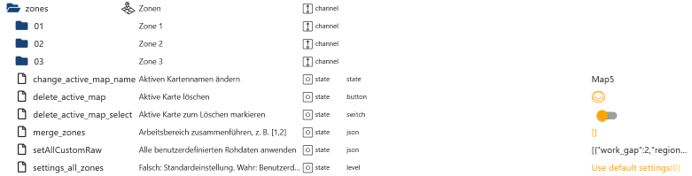

[Zusammenfassung](#zusammenfassung)

### Zone

| Objekt Id                                   | Beschreibung                                                                                                                                                                                           |
| ------------------------------------------- | ------------------------------------------------------------------------------------------------------------------------------------------------------------------------------------------------------ |
| xxx.map.zones.01.area_size                  | Zonengröße                                                                                                                                                                                             |
| xxx.map.zones.01.effective_area             | wirksame Bereich                                                                                                                                                                                       |
| xxx.map.zones.01.id                         | ID                                                                                                                                                                                                     |
| xxx.map.zones.01.mapId                      | Map ID                                                                                                                                                                                                 |
| xxx.map.zones.01.name                       | Name der Zone (änderbar)                                                                                                                                                                               |
| xxx.map.zones.01.points                     | GPS Daten der Zone                                                                                                                                                                                     |
| xxx.map.zones.01.points_num                 | Anzahl GPS Daten                                                                                                                                                                                       |
| xxx.map.zones.01.split_zones                | Diese Zone mit GPS Daten aufteilen. Aufteilung per VIS ist noch nicht implementiert.                                                                                                                   |
| xxx.map.zones.01.start_mowing_selected_area | Bereiche per VIS anlegen ist noch nicht implementiert. Welcher Pfad gemäht werden soll kann aus `xxx.map.pathData` entnommen werden. Die gewünschten Pionts in einen Array kopieren und hier einfügen. |
| xxx.map.zones.01.time_balanced              | zeitlich ausgewogen (readonly)                                                                                                                                                                         |
| xxx.map.zones.01.time_fine_tune             | zeitliche Feinabstimmung (readonly)                                                                                                                                                                    |
| xxx.map.zones.01.time_high_efficiency       | dauerhaft hohe Effizienz (readonly)                                                                                                                                                                    |

# Points

```json
[-0.3, 0.112, 11]
```

# Array

```json
[]
```

# Inhalt start_mowing_selected_area

```json
[[-0.3, 0.112, 11]]
```

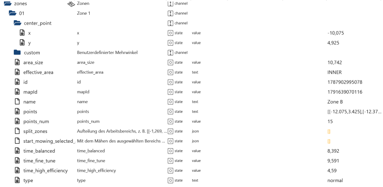

[Zusammenfassung](#zusammenfassung)

### Benutzerdefinierte Zonen Einstellung

| Objekt Id                                        | Beschreibung                                                                                                                  |
| ------------------------------------------------ | ----------------------------------------------------------------------------------------------------------------------------- |
| xxx.map.zones.01.custom.multi_angle.01           | Maximal 3 Winkel möglich                                                                                                      |
| xxx.map.zones.01.custom.multi_angle.01.active    | Winkel aktivieren/deaktivieren                                                                                                |
| xxx.map.zones.01.custom.multi_angle.01.angle     | Winkel zwischen 0°-180° ändern                                                                                                |
| xxx.map.zones.01.custom.multi_angle.angle        | Neuer Winkel zwischen 0°-180° eintragen                                                                                       |
| xxx.map.zones.01.custom.multi_angle.angle_active | Neuer Winkel aktivieren/deaktivieren                                                                                          |
| xxx.map.zones.01.custom.multi_angle.angle_create | Neuen Winkel erstellen                                                                                                        |
| xxx.map.zones.01.custom.multi_angle.delete_angle | Einen Winkel löschen                                                                                                          |
| xxx.map.zones.01.custom.currentCustomRaw         | Aktueller JSON von der Cloud von den benutzerdefinierten Einstellungen                                                        |
| xxx.map.zones.01.custom.plan_mode                | Schnittrichtung                                                                                                               |
| xxx.map.zones.01.custom.region_id                | Zonen ID                                                                                                                      |
| xxx.map.zones.01.custom.setCustomRaw             | Statt Objekte zu setzen kann man auch einen JSON versenden. Man muss den JSON unter `currentCustomRaw` verwenden und anpassen | Wenn Winkel verwendet werden muss hier die 4 ausgewählt werden |
| xxx.map.zones.01.custom.setCustomZoneSettings    | `currentCustomRaw` senden                                                                                                     |
| xxx.map.zones.01.custom.setting                  | Standardeinstellungen `xxx.settings.multi_angle` verwenden                                                                    |
| xxx.map.zones.01.custom.start                    | Änderungen sofort oder beim nächsten Mähvorgang anwenden                                                                      |
| xxx.map.zones.01.custom.work_gap                 | Schnittabstand                                                                                                                |
| xxx.map.zones.01.custom.work_speed               | Mähgeschwindigkeit                                                                                                            |

# setCustomRaw

```json
{
    "work_gap": 3,
    "region_size": 54,
    "blade_height": 40,
    "estimate_time": 30,
    "multi_zigzag_angles": [
        {
            "active": true,
            "angle": 74
        },
        {
            "active": true,
            "angle": 68
        },
        {
            "active": true,
            "angle": 117
        }
    ],
    "blade_speed": 2800,
    "plan_mode": 0,
    "region_id": 1789399960596,
    "start": 0,
    "finish": 1,
    "work_speed": 1,
    "setting": true
}
```

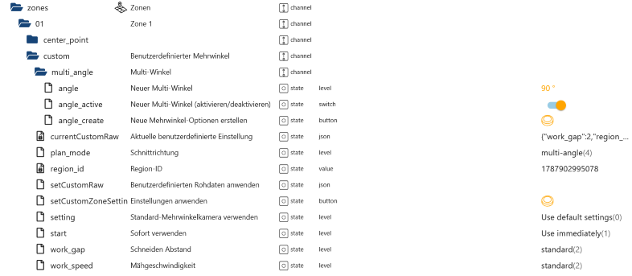

[Zusammenfassung](#zusammenfassung)

### Alle Daten vom Mäher von der Cloud und Mqtt Verbindung

`Hier werden nur einige Objekte beschrieben`

| Objekt Id                            | Beschreibung                                                |
| ------------------------------------ | ----------------------------------------------------------- |
| xxx.mower_raw.blade                  | Klingeneinstellungen (Mqtt)                                 |
| xxx.mower_raw.charge_pos             | Position Ladestation (Mqtt)                                 |
| xxx.mower_raw.consumable_items       | Verbrauchsmaterial (Mqtt)                                   |
| xxx.mower_raw.file_17                | Neue Pfaddatei hochgeladen (Mqtt)                           |
| xxx.mower_raw.file_7                 | Neue Kartendatei hochgeladen (Mqtt)                         |
| xxx.mower_raw.current_work_param     | Aktuelle Arbeitsparameter (Mqtt)                            |
| xxx.mower_raw.mcu_ver                | Mikrocontroller-Einheit (Mqtt)                              |
| xxx.mower_raw.mow_efficiency         | Mähleistung (Mqtt)                                          |
| xxx.mower_raw.current_file           | Aktuelle Pfaddatei (Mqtt)                                   |
| xxx.mower_raw.path_info              | Aktuelle Anzahl der Points vom Mähverlauf (Mqtt+GPS)        |
| xxx.mower_raw.notice                 | Letzte Nachricht (Mqtt)                                     |
| xxx.mower_raw.rain                   | Regeneinstellung (Mqtt)                                     |
| xxx.mower_raw.robot_pos              | Mäherposition (Mqtt)                                        |
| xxx.mower_raw.rtk_pos                | Echtzeitkinematik-Positionierung (Mqtt)                     |
| xxx.mower_raw.schedule_info          | Letzter geänderter Timeslot (Mqtt)                          |
| xxx.mower_raw.support_custom_pattern | Alle mögliche Muster (Mqtt)                                 |
| xxx.mower_raw.appUserId              | Benutzer ID                                                 |
| xxx.mower_raw.auto_upgrade           | Automatische Firmwareaktualisierung an/aus                  |
| xxx.mower_raw.backup_map_amount      | Anzahl der Backup-Maps                                      |
| xxx.mower_raw.base_sn                | Seriennummer der Ladestation                                |
| xxx.mower_raw.bindAntiTheftId        | ID vom 4G oder GPS Modul                                    |
| xxx.mower_raw.bladeHeight            | Klingenhöhe                                                 |
| xxx.mower_raw.bladeSpeed             | Klingengeschwindigkeit                                      |
| xxx.mower_raw.camera_sn              | Sereinnummer der Kamera                                     |
| xxx.mower_raw.camera_temp            | Temperatur der Kamera                                       |
| xxx.mower_raw.code                   | Antwort Cloud 0=Alles OK >0=Fehler                          |
| xxx.mower_raw.dev_model              | Mähermodel                                                  |
| xxx.mower_raw.dev_name               | Name vom Mäher                                              |
| xxx.mower_raw.deviceId               | Mäher ID                                                    |
| xxx.mower_raw.deviceSn               | Seriennummer vom Mäher                                      |
| xxx.mower_raw.elec                   | Batterie Level                                              |
| xxx.mower_raw.event_code             | Letzte Event                                                |
| xxx.mower_raw.id                     | ID Zuordnung der Messages über Mqtt                         |
| xxx.mower_raw.iobroker_sid           | Wird vom Adapter erstellt und wird für die Livemap benötigt |
| xxx.mower_raw.key                    | Key Zuordnung der Messages über Mqtt                        |
| xxx.mower_raw.net_4g_sig             | 4G Signalstärke                                             |
| xxx.mower_raw.path                   | Aktueller Path -> wird für die Livemap benötigt             |
| xxx.mower_raw.sid                    | SID von der APP für die Livemap                             |
| xxx.mower_raw.soc_temp               | Ladezustandstemperatur                                      |

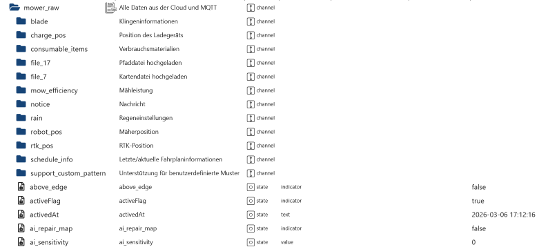
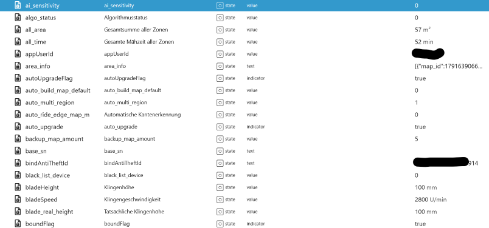
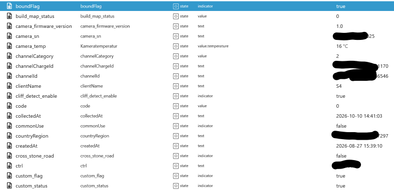
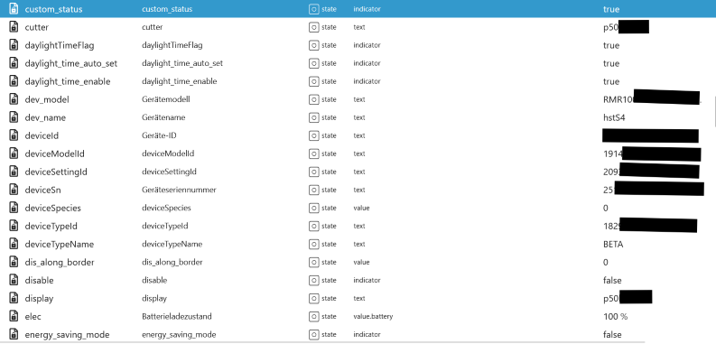
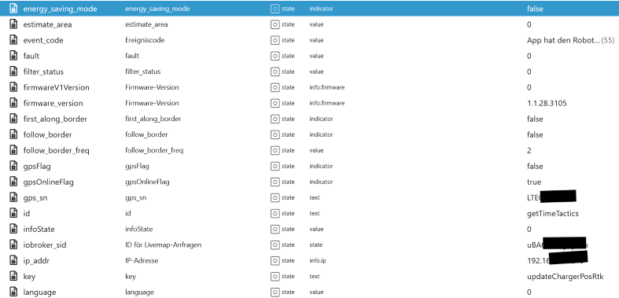
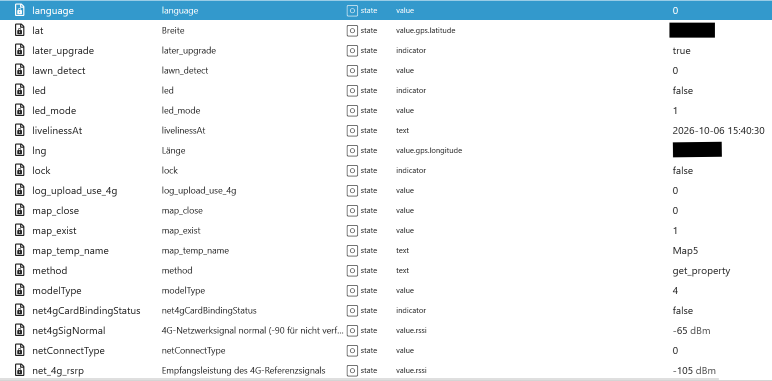
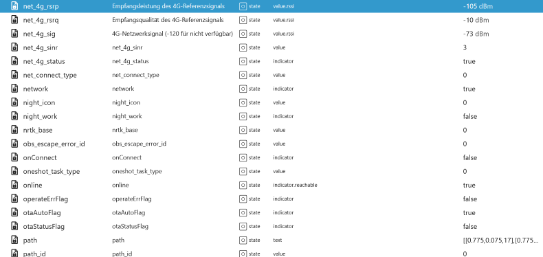
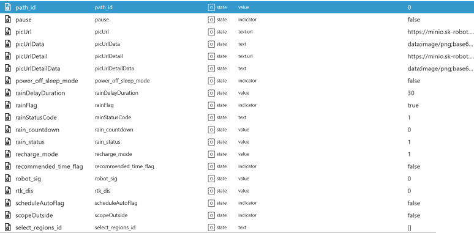
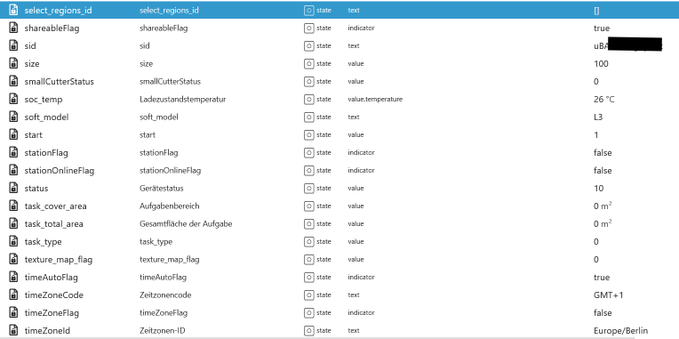
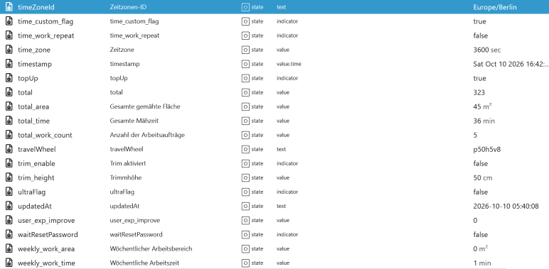
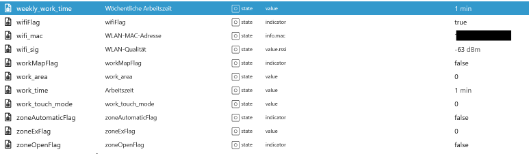

[Zusammenfassung](#zusammenfassung)

### Logs

| Objekt Id                            | Beschreibung               |
| ------------------------------------ | -------------------------- |
| xxx.notice.commonMesgage             | Allgemeine Nachrichten     |
| xxx.notice.communityActivityMessage  | Empfohlene Veranstaltungen |
| xxx.notice.deadLineWarnMessageBlade  | Klinge tauschen            |
| xxx.notice.deadLineWarnMessageCutter | Mähwerk klein reinigen     |
| xxx.notice.deadLineWarnTrimmerRope   | Trimmerseil tauschen       |
| xxx.notice.deviceExceptionMessage    | Arbeitsunregelmäßigkeiten  |
| xxx.notice.taskStatus                | Aufgabenstatus             |
| xxx.notice.trackWarningMessage       | Tracking                   |
| xxx.notice.update                    | Einstellungen neu laden    |

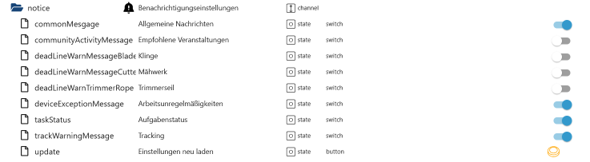

[Zusammenfassung](#zusammenfassung)

### Remote Control

| Objekt Id                      | Beschreibung                                        |
| ------------------------------ | --------------------------------------------------- |
| xxx.remote.dock                | Zurüch zur Ladestation                              |
| xxx.remote.pause               | Pause                                               |
| xxx.remote.refresh             | Status neu laden                                    |
| xxx.remote.refresh_property    | Eigenschaften neu laden                             |
| xxx.remote.set_border_distance | Schnittabstand Model V1                             |
| xxx.remote.set_border_first    | Zuerst die Kante schneiden Model V1                 |
| xxx.remote.set_return_path     | Andockmodus Model V1                                |
| xxx.remote.set_screen_duration | Automatische Bildschirmabschaltung Model V1         |
| xxx.remote.start               | Mähen starten                                       |
| xxx.remote.startZones          | Zonen mähen [Zonen-Id1, Zonen-Id2]                  |
| xxx.remote.stop                | Stop                                                |
| xxx.remote.stop_find_charger   | Cancel `zurüch zur Ladestation`                     |
| xxx.remote.border              | Kantenschneiden (V models: mode 5 mit `value:true`) |

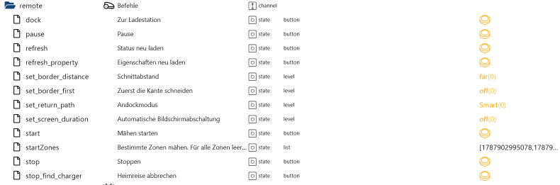

[Zusammenfassung](#zusammenfassung)

### Zeitplan

| Objekt Id                                  | Beschreibung                                                                   |
| ------------------------------------------ | ------------------------------------------------------------------------------ |
| xxx.schedule.getSchedule                   | Zeitplan von der Cloud neu laden                                               |
| xxx.schedule.pauseSchedule                 | Zeitplan pausieren                                                             |
| xxx.schedule.schedule_mode                 | Zeitplan aktivieren/deaktivieren, benutzerdefiniert oder empfohlenen           |
| xxx.schedule.schedule_time_work_repeat     | Komplette Arbeitszeit mähen                                                    |
| xxx.schedule.schedule_time_zone            | Timezone                                                                       |
| xxx.schedule.setSchedule                   | Alle Änderungen an die Cloud senden                                            |
| xxx.schedule.zones_available               | Verfügbare Zonen für z. Bsp. `0_sunday_1.zones`                                |
| xxx.schedule.0_sunday_1.active             | Immer auf true lassen                                                          |
| xxx.schedule.0_sunday_1.end                | Endzeit im Format hh:mm                                                        |
| xxx.schedule.0_sunday_1.need_follow_border | Unbekannt                                                                      |
| xxx.schedule.0_sunday_1.start              | Startzei im Format hh:mm                                                       |
| xxx.schedule.0_sunday_1.unlock             | Immer auf true lassen                                                          |
| xxx.schedule.0_sunday_1.work_order         | Benutzerdefinierte Reihenfolge. Es muss eine Zone eingetragen werden. 0=AN/Aus |
| xxx.schedule.0_sunday_1.zones              | Welche Zone gemäht werden soll, Wenn leer werden alle Zonen gemähz.            |

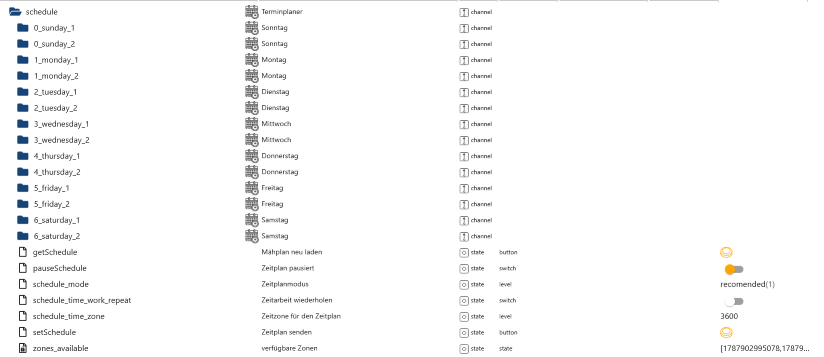
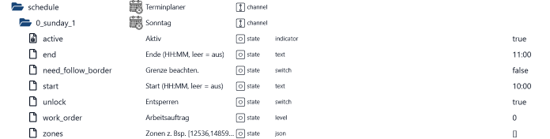

[Zusammenfassung](#zusammenfassung)

### Einstellungen

| State                          | Beschreibung                                                                                                       | Range                                                          | Unit | Notes          |
| ------------------------------ | ------------------------------------------------------------------------------------------------------------------ | -------------------------------------------------------------- | ---- | -------------- |
| `bladeSpeed`                   | Klingengeschwindigkeit                                                                                             | 2800 – 3000 (step 100)                                         | rpm  | New API only   |
| `bladeHeight`                  | Klingenhöhe                                                                                                        | 20 – 100 (step 5)                                              | mm   | New API only   |
| `rainFlag`                     | Regenverzögerung aktivieren/deaktivieren                                                                           | boolean                                                        | —    | Old + New API  |
| `rainDelayDuration`            | Verzögerungszeit nach des Regens in Minuten                                                                        | 0 – 720 (step 1)                                               | min  | Old + New API  |
| `night_work`                   | Nachtarbeit aktivieren/deaktivieren                                                                                | boolean                                                        | —    | New API only   |
| `recharge_mode`                | Andockweg                                                                                                          | 0 = direct path<br>1 = smart<br>2 = along edge                 | —    | New API only   |
| `work_touch_mode`              | Strategie zur Hindernisvermeidung                                                                                  | 0 = no touch<br>1 = slow touch                                 | —    | New API only   |
| `auto_ride_edge_map_m`         | Automatische Kantenverfolgungskartierung                                                                           | 0 = not enabled<br>1 = enabled                                 | —    | New API only   |
| `dis_along_border`             | Kantenabstand                                                                                                      | 0 = close<br>1 = far                                           | —    | New API only   |
| `first_along_border`           | Mähpräferenz                                                                                                       | boolean                                                        | —    | New API only   |
| `follow_border_freq`           | Kantenschnittfrequenz                                                                                              | 1 = everytime<br>2 = every second time<br>3 = every third time | —    | New API only   |
| `plan_mode`                    | Schnittrichtung. Bei 4 muss ein Winkel angelegt sein                                                               | 0 = default<br>1 = traceless<br>4 = multi-angle                | —    | New API only   |
| `gap`                          | Schnittabstand                                                                                                     | 1 = narrow<br>2 = standard<br>3 = wide                         | —    | New API only   |
| `workSpeed`                    | Mähgeschwindigkeit                                                                                                 | 1 = slow<br>2 = standard<br>3 = fast                           | —    | New API only   |
| `ai_sensitivity`               | KI-Sensitivität                                                                                                    | 0 = low<br>1 = high                                            | —    | New API only   |
| `dev_name`                     | Gerätename ändern                                                                                                  | string                                                         | —    | New API only   |
| `energy_saving_mode`           | Energiesparmodus                                                                                                   | boolean                                                        | —    | New API only   |
| `pin_old`                      | Alten PIN eintragen                                                                                                | number                                                         | —    | New API only   |
| `pin_new`                      | Um den Pin zu wechseln hier den neuen Pin eintragen und<br> unter `pin_old` den Alten Pin                          | number                                                         | —    | New API only   |
| `custom_flag`                  | Unbekannt                                                                                                          | boolean                                                        | —    | New API only   |
| `auto_upgrade`                 | Automatische Firmware Update aktivieren/deaktivieren                                                               | boolean                                                        | —    | New API only   |
| `reset_bladeplate`             | Klingenplattenzähler zurücksetzen                                                                                  | boolean                                                        | —    | New API only   |
| `reset_blade`                  | Klingenzähler zurücksetzen                                                                                         | boolean                                                        | —    | New API only   |
| `reset_smal_bladeplate`        | Kleine Klingenplattenzähler zurücksetzen                                                                           | boolean                                                        | —    | New API only X |
| `reset_smal_blade`             | Kleine Klingenzähler zurücksetzen                                                                                  | boolean                                                        | —    | New API only X |
| `firmware_available`           | Aktuelle verfügbare Firmware                                                                                       | string                                                         | —    | New API only   |
| `firmware_description`         | Beschreibung der aktuelle Firmware                                                                                 | string                                                         | —    | New API only   |
| `firmware_update_available`    | Ist ein Update verfügbar true=ja und false=nein                                                                    | boolean                                                        | —    | New API only   |
| `firmware_update_check_manual` | Es wird nach Adapterstart alle 24h geprüft.<br>Hiermit kann man manuell prüfen, ob ein Update zur Verfügung steht. | boolean                                                        | —    | New API only   |
| `firmware_update_start`        | Firmware Update starten.                                                                                           | boolean                                                        | —    | New API only   |

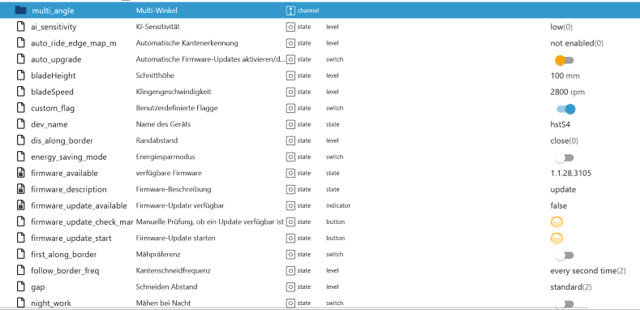
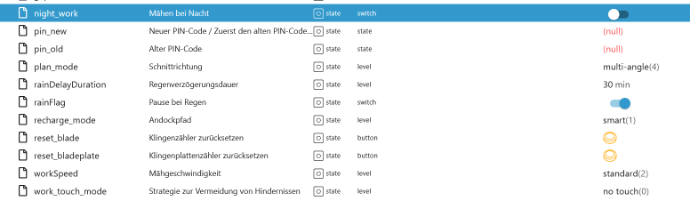

[Zusammenfassung](#zusammenfassung)

### Einstellungen Multi-Winkel

| Objekt Id                             | Beschreibung                            |
| ------------------------------------- | --------------------------------------- |
| xxx.settings.multi_angle.01           | Es können nur 3 Winkel erstellt werden  |
| xxx.settings.multi_angle.01.active    | Winkel aktivieren/deaktivieren          |
| xxx.settings.multi_angle.01.angle     | Winkel zwischen 0°-180° ändern          |
| xxx.settings.multi_angle.angle        | Neuer Winkel zwischen 0°-180° eintragen |
| xxx.settings.multi_angle.angle_active | Neuer Winkel aktivieren/deaktivieren    |
| xxx.settings.multi_angle.angle_create | Neuen Winkel erstellen                  |
| xxx.settings.multi_angle.delete_angle | Einen Winkel löschen                    |

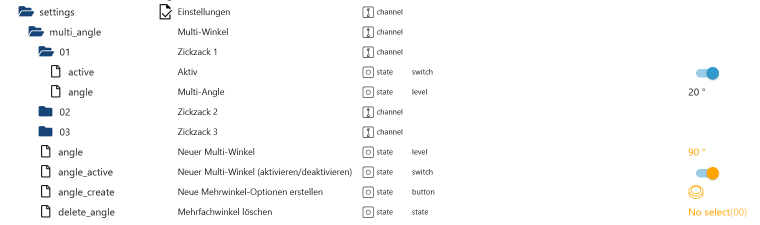

[Zusammenfassung](#zusammenfassung)

### Skins

| Objekt Id | Beschreibung |
| --------- | ------------ |

<!--

-->

[Zusammenfassung](#zusammenfassung)

### Communities

| Objekt Id | Beschreibung |
| --------- | ------------ |

<!--

-->

[Zusammenfassung](#zusammenfassung)

### Kreditkarten

| Objekt Id | Beschreibung |
| --------- | ------------ |

<!--

-->

[Zusammenfassung](#zusammenfassung)

### Autorisierung

| Objekt Id               | Beschreibung                                                                  |
| ----------------------- | ----------------------------------------------------------------------------- |
| auth.app_id             | Wird vom Adapter erstellt und wird für einige Anfragen an die Cloud benötigt. |
| auth.mqtt_connected     | Status Mqtt Verbindung für S/X/V Modelle                                      |
| auth.mqtt_connected_V1  | Status Mqtt Verbindung für V1 Modell                                          |
| auth.mqtt_connected_old | Status Mqtt Verbindung für Mäher mit Kabel                                    |
| auth.mqtt_connection    | Zugangsdaten für die Mqtt Verbindung                                          |
| auth.session            | Zugangsdaten für die Cloud Verbindung                                         |

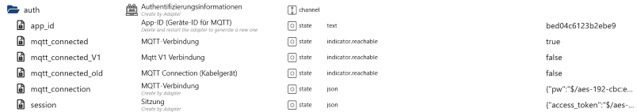

[Zusammenfassung](#zusammenfassung)

### Request Begrenzung

| Objekt Id         | Beschreibung                                                                                                  |
| ----------------- | ------------------------------------------------------------------------------------------------------------- |
| rateLimit.request | Hier kann eingesehen werden welche Request an die Cloud gesendet werden. Ein Schutz gegen fehlerhaft Scripte. |
| rateLimit.restart | Hier werden die Restarts vom Adapter pro Tag gezhählt. Ein Schutz gegen fehlerhaft Scripte.                   |

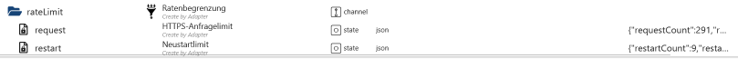

### JSON Request

```json
{
    "requestCount": 291,
    "requestLast": 1791627513938,
    "requestTime": "2026-10-10T10:18:33.938Z",
    "requestBlock": false,
    "day": "41-6",
    "request": [
        {
            "count": 291,
            "method": "GET",
            "urlPath": "/wireless_map/wireless_device/get?deviceSn=123",
            "timestamp": 1791657143977,
            "time": "2026-10-10T18:32:23.977Z"
        },
        {
            "count": 290,
            "method": "POST",
            "urlPath": "/ota/firmware-large/wireless/check",
            "data": "{\"deviceSn\":\"123\",\"deviceSpecies\":0,\"deviceType\":0,\"version\":\"1.1.28.3105\"}",
            "timestamp": 1791657088209,
            "time": "2026-10-10T18:31:28.209Z"
        }
    ]
}
```

### JSON Restart

```json
{
    "restartCount": 9,
    "restartLast": 1791627513938,
    "restartTime": "2026-10-10T10:18:33.938Z",
    "day": "41-6"
}
```

[Zusammenfassung](#zusammenfassung)
